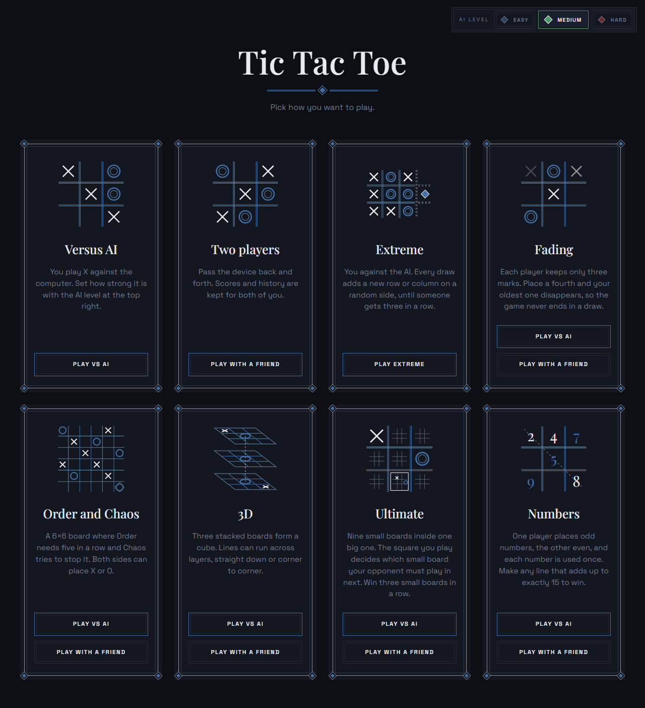
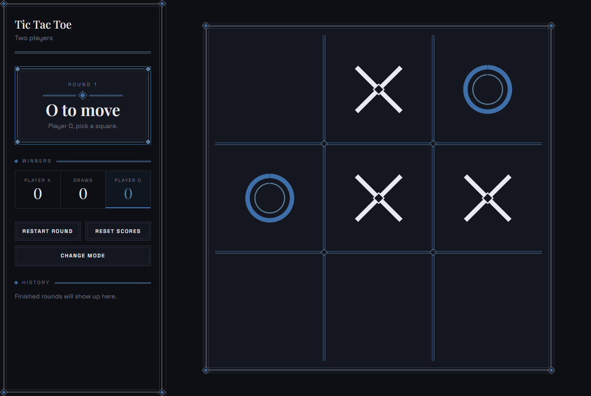
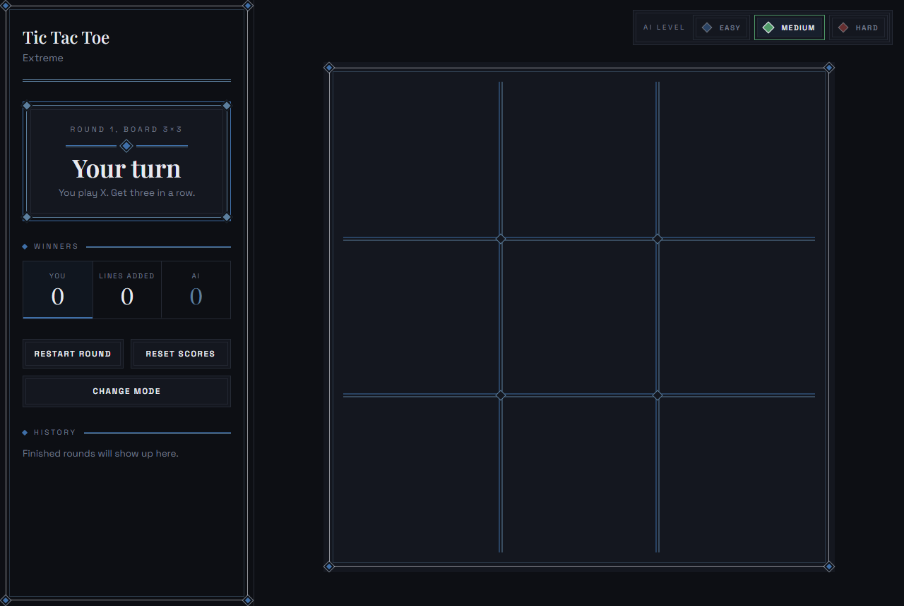
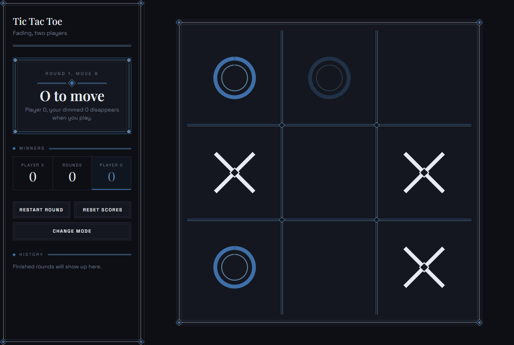
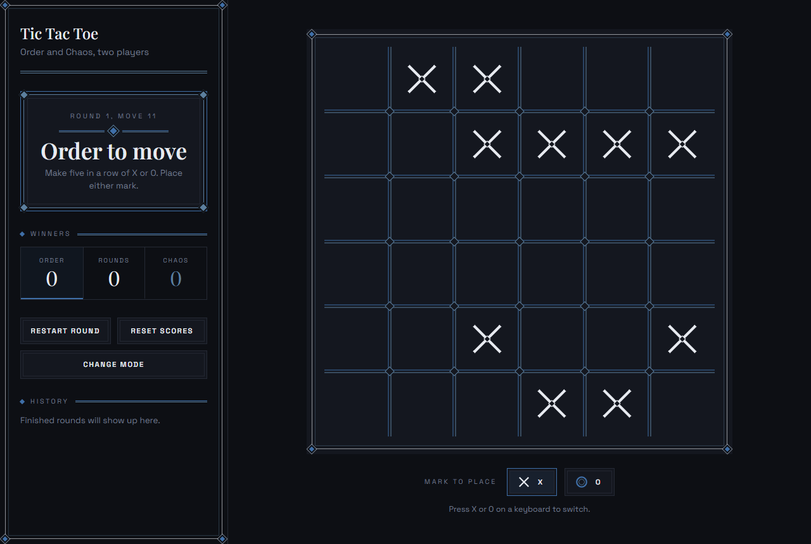
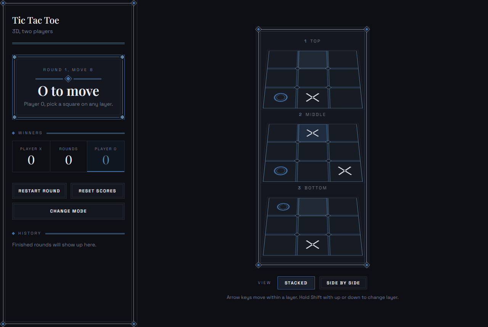
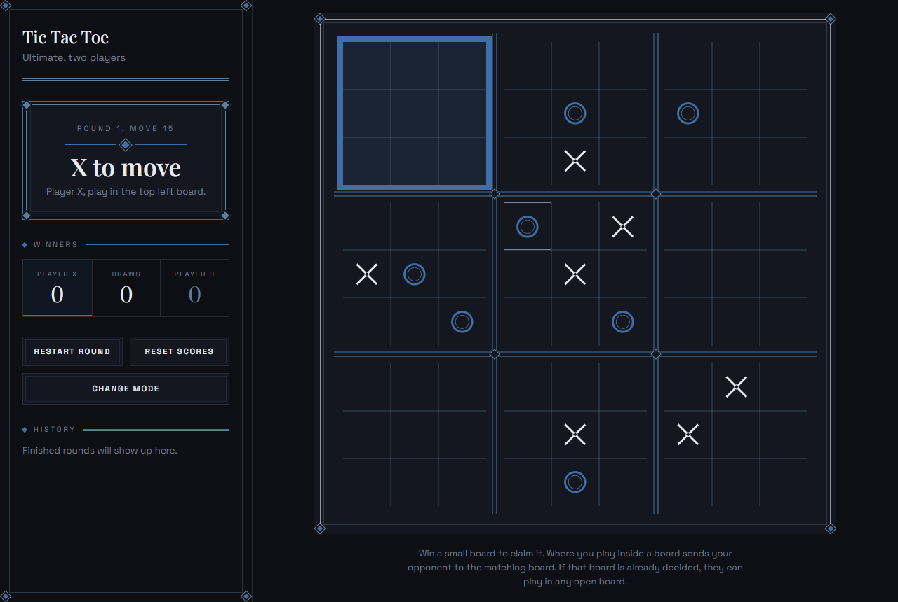
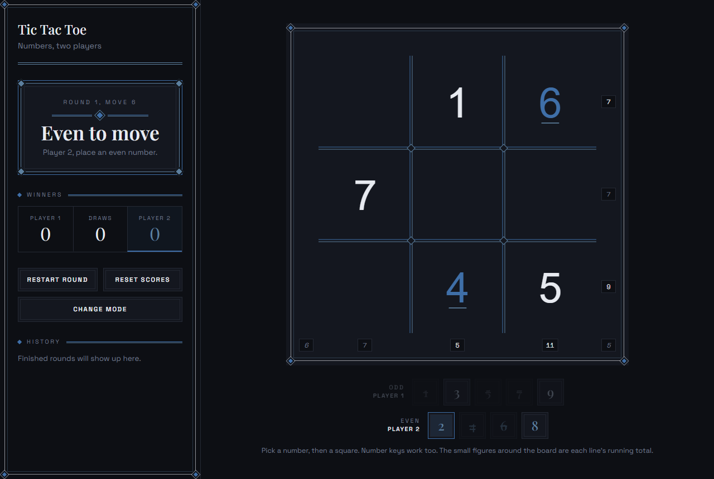

# Ultimate Tic Tac Toe

A collection of styles and versions of tic tac toe, from the classic game to boards that grow, fade, stack into a cube, or nest inside each other. Play against the computer or with a friend.

This project is built as a single, standalone HTML file. Everything it needs (structure, styles, and scripts) lives inside that one file, so there is nothing to install, build, or configure. If you have a web browser, you can run it.



## Game Modes

| Mode | How it works | Play against |
| --- | --- | --- |
| **Versus AI** | Classic 3×3. You play X against the computer. | AI |
| **Two players** | Classic 3×3, passed back and forth on one device. | Friend |
| **Extreme** | Every draw adds a new row or column on a random side, until someone gets three in a row. | AI |
| **Fading** | Each player keeps only three marks. Place a fourth and your oldest one disappears, so the game never ends in a draw. | AI or friend |
| **Order and Chaos** | A 6×6 board where Order needs five in a row and Chaos tries to stop it. Both sides can place X or O. | AI or friend |
| **3D** | Three stacked boards form a cube. Lines can run across layers, straight down, or corner to corner. | AI or friend |
| **Ultimate** | Nine small boards inside one big one. The square you play decides which small board your opponent must play in next. Win three small boards in a row. | AI or friend |
| **Numbers** | One player places odd numbers, the other even, and each number is used once. Make any line that adds up to exactly 15 to win. | AI or friend |

The AI has three levels (**Easy**, **Medium**, **Hard**), set from the top right of the menu. Scores and round history are kept per mode and saved in your browser.

## Screenshots

### Classic


### Extreme


### Fading


### Order and Chaos


### 3D


### Ultimate


### Numbers


## Features

- **No installation**: no dependencies, no package managers, no build step
- **Works offline**: once downloaded, it runs without an internet connection
- **Portable**: copy it to a USB drive, email it, or keep it on your desktop
- **Cross-platform**: runs on Windows, macOS, Linux, ChromeOS, Android, and iOS
- **Private**: runs entirely in your browser, nothing is sent to a server
- **Keyboard friendly**: arrow keys move between squares

## Getting Started

### Option 1: Download the file

1. Download `index.html` from this repository (open the file and click **Download raw file**)
2. Save it anywhere on your computer
3. Double-click the file to open it in your default browser

### Option 2: Play online

If GitHub Pages is active for this repository, you can play directly at:

```
https://lro-ui.github.io/Ultimate_Tic_Tac_Toe/
```

Each mode also has its own link, for example `#ult-pvp` for Ultimate with a friend or `#cube-ai` for 3D against the AI.

## Requirements

Any modern web browser, such as:

- Google Chrome
- Mozilla Firefox
- Microsoft Edge
- Safari
- Opera / Brave

That's it. No internet connection, server, or additional software required.

## Project Structure

```
.
├── index.html     # The entire application
├── screenshots/   # Images used in this README
└── README.md      # This file
```

## Customization

Since everything is in one file, you can open `index.html` in any text editor to change text, colors, or behavior. Save the file and refresh your browser to see the changes.
